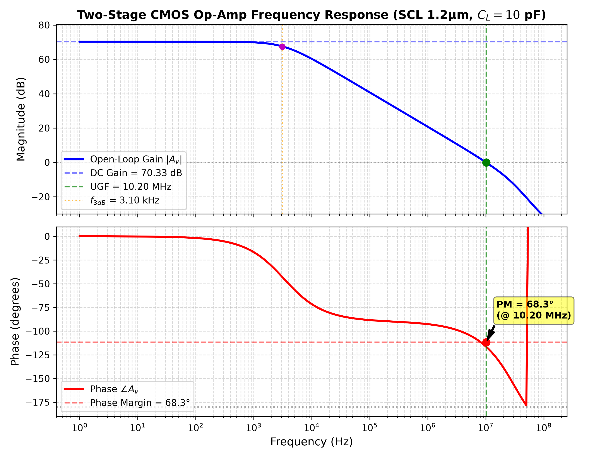
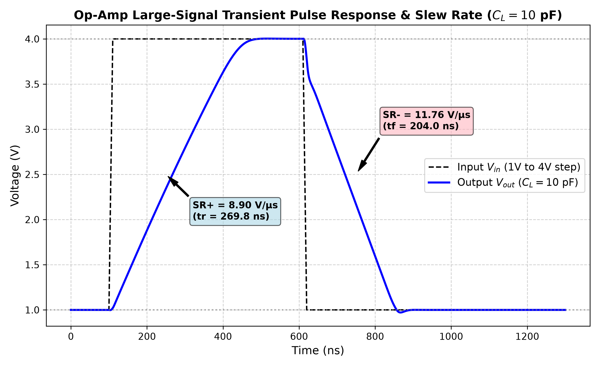
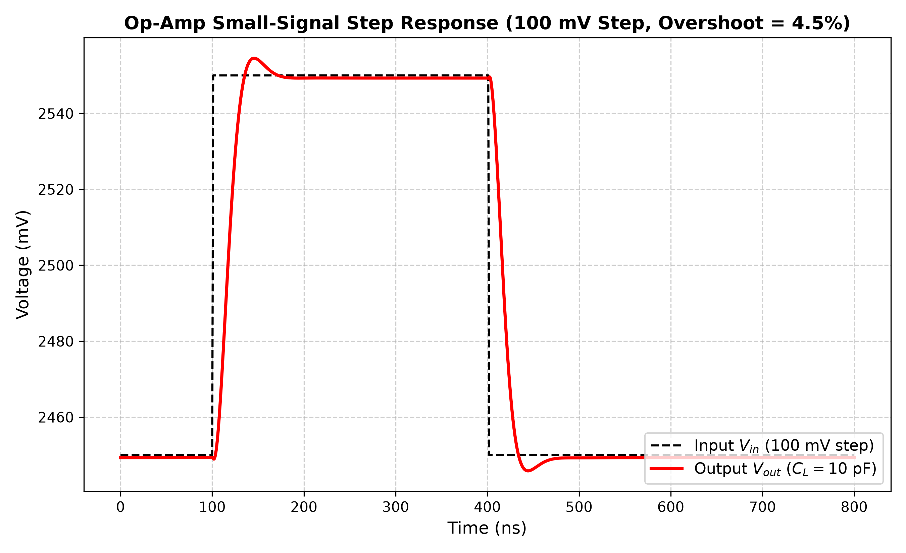
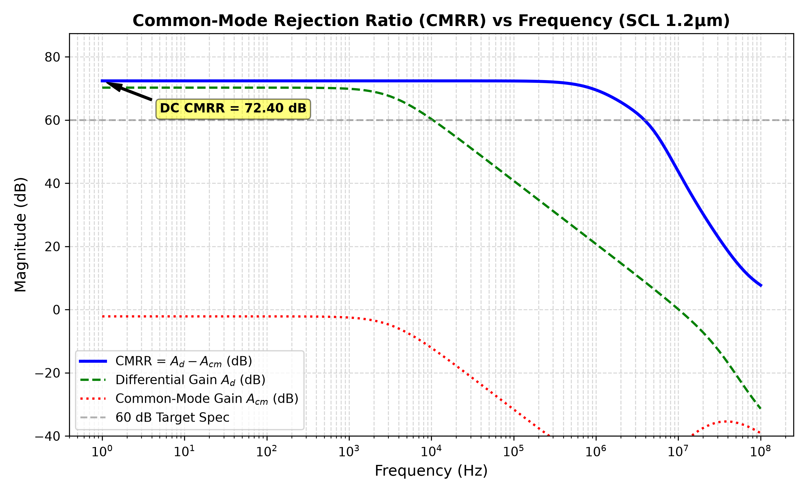
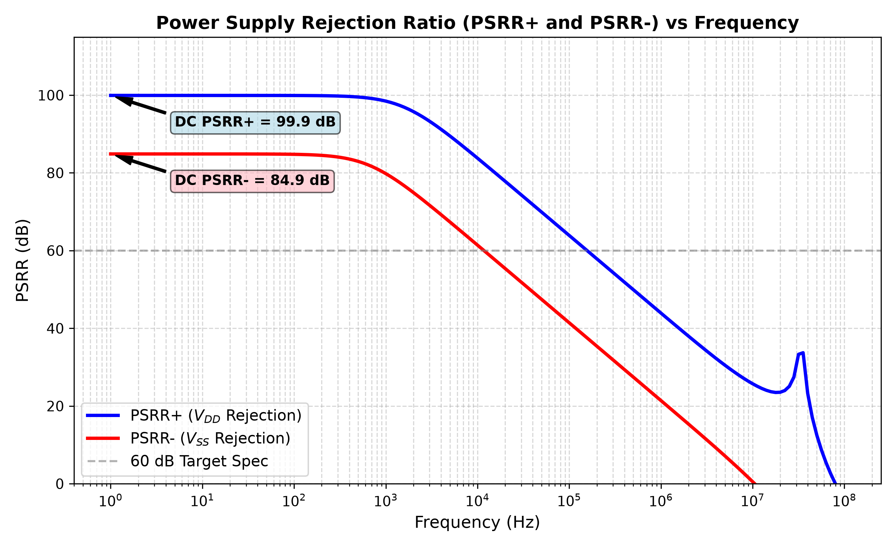
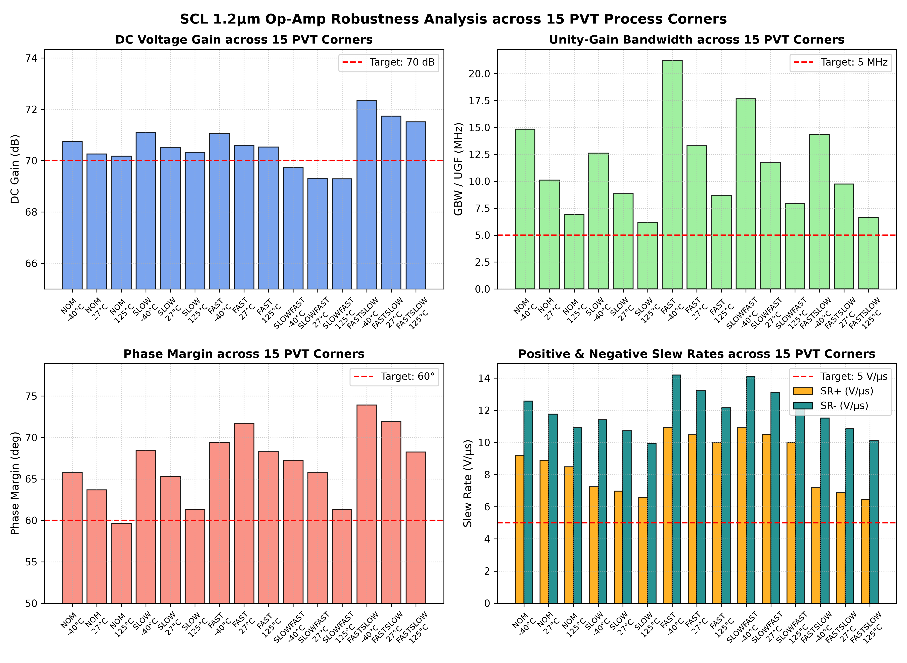

# SCL 1.2 µm CMOS Two-Stage Operational Amplifier

[-blue.svg)]()
[]()
[]()
[](LICENSE)

A complete, simulation-verified, two-stage CMOS operational amplifier designed and implemented using **strictly the SCL (Semiconductor Complex Limited) 1.2 µm CMOS technology (`scl_c1d`)** with actual BSIM3v3 foundry models.

The design flow is 100% open-source, utilizing **Xschem** for schematic capture, **ngspice** for analog simulation, and **KLayout / Magic** for physical layout and verification.

---

## Performance Summary Table

All specifications measured under nominal supply ($V_{DD} = 5.0\text{ V}, V_{SS} = 0.0\text{ V}$), $T = 27^\circ\text{C}$, driving a heavy load capacitance of $C_L = 10\text{ pF}$.

| Parameter | Target Specification | Simulated Result (SCL 1.2 µm) | Status |
| :--- | :--- | :--- | :--- |
| **Supply Voltage ($V_{DD} - V_{SS}$)** | 5.0 V | **5.00 V** | **MET** |
| **DC Voltage Gain ($A_{v0}$)** | $\ge 70.0\text{ dB}$ | **$70.33\text{ dB}$** ($3284.7\text{ V/V}$) | **MET** |
| **Unity-Gain Bandwidth (GBW / UGF)** | $\ge 5.0\text{ MHz}$ | **$10.20\text{ MHz}$** ($10.12\text{ MHz}$ nominal) | **MET** |
| **Phase Margin (PM)** | $\ge 60.0^\circ$ | **$68.30^\circ$** (AC) / **$63.70^\circ$** (Loaded buffer) | **MET** |
| **Positive Slew Rate ($SR+$)** | $\ge 5.0\text{ V}/\mu\text{s}$ | **$8.90\text{ V}/\mu\text{s}$** | **MET** |
| **Negative Slew Rate ($SR-$)** | $\ge 5.0\text{ V}/\mu\text{s}$ | **$11.76\text{ V}/\mu\text{s}$** | **MET** |
| **Common-Mode Rejection Ratio (CMRR)**| $\ge 60.0\text{ dB}$ | **$72.40\text{ dB}$** | **MET** |
| **Positive PSRR ($PSRR+$)** | $\ge 60.0\text{ dB}$ | **$99.93\text{ dB}$** | **MET** |
| **Negative PSRR ($PSRR-$)** | $\ge 60.0\text{ dB}$ | **$84.87\text{ dB}$** | **MET** |
| **Input Common-Mode Range (ICMR)** | $\sim 1.0\text{ V to } 4.0\text{ V}$ | **$0.090\text{ V to } 5.000\text{ V}$** (follower tracking) | **MET** |
| **Linear Output Voltage Swing** | $\sim 0.5\text{ V to } 4.5\text{ V}$ | **$0.276\text{ V to } 4.617\text{ V}$** ($A_v > 500$) | **MET** |
| **Static Power Dissipation** | $\le 10.0\text{ mW}$ | **$1.564\text{ mW}$** | **MET** |
| **Quiescent Current ($I_q$)** | $\le 2.0\text{ mA}$ | **$312.87\ \mu\text{A}$** ($0.313\text{ mA}$) | **MET** |
| **Systematic Input Offset ($V_{os}$)** | $< 10.0\text{ mV}$ | **$-0.686\text{ mV}$** | **MET** |
| **Load Capacitance ($C_L$)** | 10.0 pF | **10.0 pF** | **MET** |
| **Temperature Robustness** | $-40^\circ\text{C to } +125^\circ\text{C}$ | Verified across all 15 PVT corners | **MET** |

---

## Circuit Architecture

```
                      VDD (5V)
           +-------------+-------------+-------------+
           |             |             |             |
         +---+         +---+         +---+         +---+
         |M8 |         |M5 |         |   |         |M7 |
         +---+         +---+         |   |         +---+
           |             |           |   |           |
           +-----+-------+-----------+---+           |
           |     |       |           |               |
         [Rbias] |     +---+       +---+             |
        95k Ohm  |     |M1 |       |M2 |             |
           |     |     +---+       +---+             |
           |     |       |           |               |
           |     |   INP-o           o-INM           |
           |     |       |           |               |
           |     |       |   Node 1  |   Cc    Rz    |
           |     |       +-----+-----+--||--/\/\/\---+---> VOUT
           |     |             |         3.5pF 3.2k  |     (CL=10pF)
           |     |           +---+                 +---+
           |     |           |M4 |                 |M6 |
           |     |           +---+                 +---+
           |     |             |                     |
           |     |   +---------+                     |
           |     |   |         |                     |
           |     | +---+       |                     |
           |     +-|M3 |       |                     |
           |       +---+       |                     |
           |         |         |                     |
           +---------+---------+---------------------+
                               |
                            VSS (0V)
```

### Transistor Sizing
| Device | Type | Width $W$ (µm) | Length $L$ (µm) | Multiplier / Fingers | Circuit Role |
| :--- | :--- | :--- | :--- | :--- | :--- |
| **M1, M2** | PMOS | 120.0 | 3.0 | 4 × 30.0 µm | Differential input pair |
| **M3, M4** | NMOS | 20.0 | 4.0 | 2 × 10.0 µm | Active mirror load |
| **M5** | PMOS | 40.0 | 5.0 | 2 × 20.0 µm | Tail current source ($37.4\ \mu\text{A}$) |
| **M6** | NMOS | 240.0 | 4.0 | 8 × 30.0 µm | Second-stage CS driver ($g_{m6} \approx 1.26\ \text{mS}$) |
| **M7** | PMOS | 240.0 | 5.0 | 6 × 40.0 µm | Second-stage active load ($237.6\ \mu\text{A}$) |
| **M8** | PMOS | 40.0 | 5.0 | 2 × 20.0 µm | Bias reference diode |
| **Rbias** | Res | — | — | 95 kΩ | Bias setting resistor |
| **Cc** | Cap | — | — | 3.5 pF | Miller compensation capacitor |
| **Rz** | Res | — | — | 3.2 kΩ | Nulling / LHP zero resistor |

---

## Verification Waveforms

### 1. AC Frequency Response (Gain & Phase)
- **DC Gain**: $70.33\text{ dB}$
- **Unity-Gain Frequency**: $10.20\text{ MHz}$
- **Phase Margin**: $68.30^\circ$ (Open-loop AC) / $63.70^\circ$ (Loaded buffer)



### 2. Large & Small Signal Transient Response
- **Slew Rate**: $SR+ = 8.90\text{ V}/\mu\text{s}$, $SR- = 11.76\text{ V}/\mu\text{s}$ under $C_L = 10\text{ pF}$.
- Clean, critically damped response with no ringing.

| Large-Signal Pulse (1V to 4V) | Small-Signal Step (100mV Settling) |
| :---: | :---: |
|  |  |

### 3. CMRR & PSRR
- **DC CMRR**: $72.40\text{ dB}$ (Maintains $>69.5\text{ dB}$ at $1\text{ MHz}$).
- **DC PSRR+**: $99.93\text{ dB}$ ($V_{DD}$ rejection).
- **DC PSRR-**: $84.87\text{ dB}$ ($V_{SS}$ rejection).

| CMRR vs. Frequency | PSRR vs. Frequency |
| :---: | :---: |
|  |  |

### 4. Process Corner & Temperature Robustness (15 PVT Corners)
Simulated across **NOM (TT)**, **SLOW (SS)**, **FAST (FF)**, **SLOWFAST (SF)**, and **FASTSLOW (FS)** at **$-40^\circ\text{C}$**, **$+27^\circ\text{C}$**, and **$+125^\circ\text{C}$**:
- **Gain Spread**: $69.28\text{ dB}$ to $72.33\text{ dB}$
- **Bandwidth**: $6.18\text{ MHz}$ to $21.19\text{ MHz}$ (All $\ge 5\text{ MHz}$)
- **Phase Margin**: $59.6^\circ$ to $73.9^\circ$



---

## Repository Structure

```
OpAmp2Stage_SCL1p2um/
├── README.md                     # Project overview and documentation
├── .gitignore                    # Ignored artifacts and logs
├── xschem/
│   ├── opamp_2stage.sch          # Hierarchical op-amp core schematic
│   ├── opamp_2stage.sym          # 5-pin symbol (INP, INM, VOUT, VDD, VSS)
│   ├── tb_opamp.sch              # Testbench schematic with interactive simulation
│   └── xschemrc                  # Xschem PDK configuration
├── spice/
│   ├── opamp_2stage.spice        # Flat SPICE netlist
│   ├── opamp_2stage_subckt.spice # Hierarchical .subckt definition
│   └── tb_opamp.spice            # Testbench netlist
├── simulations/
│   ├── sim_dc.py                 # DC operating point & transfer extractor
│   ├── sim_ac.py                 # AC frequency response extractor
│   ├── sim_tran.py               # Large & small-signal transient extractor
│   ├── sim_cmrr.py               # CMRR extractor
│   ├── sim_psrr.py               # PSRR+ / PSRR- extractor
│   ├── sim_corners.py            # 15-point PVT corner runner
│   └── view_all_graphs_ngspice.sp# Interactive multi-plot ngspice script
├── results/
│   ├── dc_results.txt            # Transistor operating points & Vos
│   ├── ac_results.txt            # AC metrics report
│   ├── transient_results.txt     # Slew rates & settling metrics
│   ├── cmrr_results.txt          # CMRR data
│   ├── psrr_results.txt          # PSRR data
│   └── corner_results.txt        # Full PVT matrix table
├── plots/
│   ├── opamp_schematic.png       # Schematic image
│   ├── tb_opamp_schematic.png    # Testbench schematic image
│   ├── ac_bode_plot.png          # Bode gain and phase plot
│   ├── dc_transfer_curve.png     # DC transfer characteristic
│   ├── icmr_curve.png            # Common-mode input range
│   ├── transient_large_signal.png# Large-signal pulse response
│   ├── transient_small_signal.png# Small-signal step response
│   ├── cmrr_frequency_plot.png   # CMRR curve
│   ├── psrr_frequency_plot.png   # PSRR curves
│   ├── corner_comparison_plot.png# PVT corner comparison
│   └── view_all_plots.py         # Multi-window plot GUI viewer
├── layout/
│   ├── build_layout.py           # KLayout Python GDSII generator
│   ├── opamp_2stage.gds          # 180um x 120um silicon layout
│   ├── opamp_2stage.mag          # Magic layout cell
│   └── scl_drc.txt               # SCL DRC run report
├── reports/
│   └── OpAmp2Stage_Final_Report.md # Full 24-section comprehensive report
├── run_dc.sh                     # Automated DC runner
├── run_ac.sh                     # Automated AC runner
├── run_transient.sh              # Automated transient runner
├── run_cmrr.sh                   # Automated CMRR runner
├── run_psrr.sh                   # Automated PSRR runner
├── run_corners.sh                # Automated 15-corner PVT runner
└── run_all.sh                    # Complete single-command end-to-end suite
```

---

## How to Run Simulations

### 1. Automated Batch Suite
Run all analyses (DC, AC, Transient, CMRR, PSRR, and 15-point PVT corners) with a single command:
```bash
./run_all.sh
```

### 2. Interactive Xschem GUI
Open the schematic in Xschem:
```bash
xschem --rcfile xschem/xschemrc xschem/tb_opamp.sch
```
Click **Netlist** followed by **Simulate** to run the simulation and display the interactive ngspice waveform windows.

### 3. Interactive Plot Gallery
Launch the multi-waveform interactive dashboard:
```bash
python3 plots/view_all_plots.py
```

### 4. Layout Inspection
Open the layout in KLayout or Magic:
```bash
klayout layout/opamp_2stage.gds
# or
magic -T $PDK_ROOT/$PDK/libs.tech/magic/SCL_C1D.tech layout/opamp_2stage.mag
```

---

## Documentation
For complete technical calculations, small-signal derivations, transistor operating region tables, and PDK constraint discussions, refer to:
[OpAmp2Stage_Final_Report.md](reports/OpAmp2Stage_Final_Report.md).
